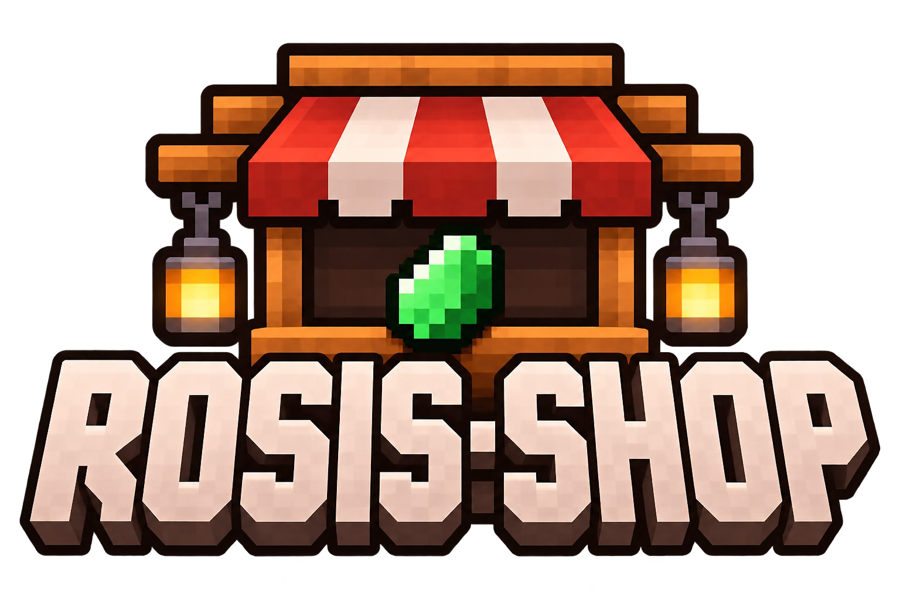

# Rosis Shop

<p align="center">
  
</p>

Player-run shops for **Minecraft 1.21.1 · NeoForge**. Set a price, stock your shop,
and let other players buy from it.

## Shops and trading

- Build crates, counters, shelves, hanging displays, glass displays, and rugs.
  Wooden shops come in eleven wood types.
- Set fixed item quantities for each trade. Price and product slots use ghost
  items; configuring an offer does not consume the item in your cursor.
- Keep stock and collected payments in the shop. Customers can see the
  remaining stock in the trading screen.
- Buy through the shop screen, or sneak and left-click for a quick purchase.
  Aim at the upper or lower shelf to select its offer.
- Assign staff access through signed contracts. Creative shops have unlimited stock.
- Configure purchase sounds, particles, and feedback for failed trades.

Trade matching ignores durability damage. Names, enchantments, and other item
components must match. Purchases retain the durability of the actual stock.
Selectable trades and an ignore-item-data mode are not currently available.

## Installation

Use **JDK 21**, **Minecraft 1.21.1**, and **NeoForge 21.1.65 or later in the 21.1 series**.
Put `rosis-shop-2.1.0.jar` in the `mods` folder on both the client and server.
Use the same version on both.

Worlds, datapacks, and resource packs must use the `rosis_shop` namespace.
This build does not convert other registry namespaces or import other config files.

## Configuration

The first launch creates `config/rosis_shop.toml`. Shop permissions and trades
are configured through the shop screen. Sound and particle settings live in
this file; restart the game or server after editing it.

```toml
ToggleEffectsDefault = true
PurchaseSounds = true
PurchaseSound = "minecraft:entity.item.pickup"
PurchaseVolume = 0.45
PurchasePitch = 0.8
PurchaseParticles = true
PurchaseParticle = "minecraft:happy_villager"
PurchaseParticleCount = 6
OutOfStockSounds = true
OutOfStockSound = "minecraft:block.dispenser.fail"
OutOfStockVolume = 0.35
OutOfStockPitch = 0.9
InsufficientCurrencySounds = true
InsufficientCurrencySound = "minecraft:entity.villager.no"
InsufficientCurrencyVolume = 0.5
InsufficientCurrencyPitch = 1.2
RegisterFullSounds = true
RegisterFullSound = "minecraft:block.dispenser.fail"
RegisterFullVolume = 0.5
RegisterFullPitch = 0.65
```

Volume is clamped to 0–2, pitch to 0.5–2, and particle count to 0–64 per burst.
Set particle count to 0 or disable the effect to turn it off. Particle IDs must
refer to simple particle types, such as `happy_villager`, `heart`, or `end_rod`.

## Build

Requires JDK 21. The Gradle wrapper downloads dependencies on the first run.

```bash
git clone https://github.com/oNxZero/rosis-shop.git
cd rosis-shop
bash gradlew build
```

On Windows, use `gradlew.bat build`. Output: `build/libs/rosis-shop-2.1.0.jar`.

The build runs trade and packet regressions. Model geometry and resource
references can also be checked with Python 3:

```bash
python3 tools/check_shop_models.py
python3 tools/check_resources.py
```

To regenerate wood variants and connected-rug models, run
`python3 tools/generate_shop_models.py`.

## Problems

[Open an issue](https://github.com/oNxZero/rosis-shop/issues) with your Minecraft
and NeoForge versions, other relevant mods, reproduction steps, and logs.
For inventory problems, include the shop type, item quantities, and click or
sorting action involved.

## License

[MIT](LICENSE.txt). Copyright notices are included in the source and built JAR.
