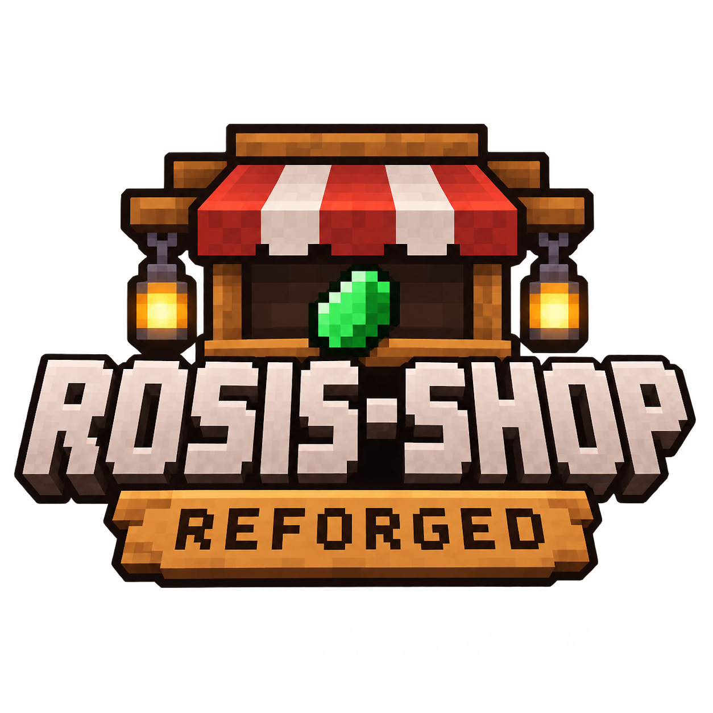

# Rosis Shop

<p align="center">
  
</p>

Decorative player shops for **Minecraft 1.21.1 • NeoForge**, with fixes for item duplication, trade accounting, and inventory interactions.


## What you can do

- Build decorative shops using crates, shelves, hanging displays, rugs, and wooden counters. Shelves have a compact hanging price tag on the front edge for each offer (price, then payment item).
- Configure a fixed payment and product quantity for each shop inventory.
- Choose from eleven wood variants for crates, shelves, and normal wooden shops. Existing legacy crates remain compatible.
- Wooden model surfaces use vanilla planks and stripped logs, so resource packs change them naturally.
- Crates have closed trays and timber stands with horizontal grain on rails and crossbeams.
- Adjacent rugs use non-overlapping connection geometry to prevent seam flicker.
- Keep stock and collected payments in the shop.
- See remaining matching stock beneath the product in the buying GUI, updated live. Creative shops show unlimited stock (`∞`).
- Assign staff permissions through signed contracts.
- Configure creative shops and visual effects.
- As a customer, sneak (Shift) and left-click a shop to buy one configured trade without opening its GUI. Aim at the upper or lower shelf to select its offer. Owners and staff keep their normal controls.
- Every successful purchase plays a soft item-pickup sound, with a small green particle burst at the shop. Bulk purchases throttle only particles. Failed purchases give the buyer distinct feedback for empty stock, insufficient currency, and a full register. Purchase sounds are sent directly to the buyer, including while the GUI is open.

Trade configuration uses **ghost items**: setting a price or product does not consume the item in your cursor. Actual purchases consume real payment and stock.

## Trade and inventory handling

| Area | Changes |
| --- | --- |
| Duplication prevention | Excludes trade templates from inventory sorting, blocks ghost-item hotbar swaps across tabs, and blocks contract-scroll hotbar swaps. |
| InvTweaks Refoxed | Registers its supported blacklist for shop screens; shop-container sorting is intentionally disabled. |
| Trade accounting | Extracts exact quantities across multiple stacks, including items with stack limits of 16 or 1. Adds item-conservation regression checks. |
| Trade validation | Executes trades on the server and checks the player, dimension, distance, and current shop block entity before trading. |
| Shelf inventories | Uses the selected shelf inventory when opening the customer menu. |
| Shift-click | Restricts bulk purchases to the product slot, includes the final hotbar slot when withdrawing stock, and completes transfer callbacks. |
| Inventory display | Refreshes server slot state after owner-menu transfers to address stale item displays during rapid transfers. |
| Contracts | Avoids a server-side exception when clicking your own contract to open the removal warning. |

**Validation:** the build and regression checks pass, including exact extraction, repeated-purchase stock conservation, register capacity, and durability matching. Quick-buy mouse behavior, sound feedback, Mouse Tweaks visual behavior, and combined mod interactions still need in-game verification. These fixes are not a claim that every possible exploit has been eliminated.

Selectable trades and an ignore-item-data mode are not implemented in this fork. Shops use fixed item-and-quantity trades. Trade matching ignores durability damage, while names, enchantments, and other item components must still match. Purchased items retain the durability of the actual stock.

## Installation

1. Install **Minecraft 1.21.1** with **NeoForge** (the current build targets NeoForge **21.1.65**).
2. Obtain the Rosis Shop JAR from the maintainer, or build it using the instructions below.
3. Put it in the `mods` folder on the client and server.
4. Replace the previous shop mod JAR on both the client and server. Use the same version on both.

The mod ID is `rosis_shop`. Compatibility aliases resolve the previous registry IDs
when loading existing shops and inventories. Back up your world before upgrading;
custom resource packs and integrations should use the new namespace.

## Configuration

The config lives at:

```text
config/rosis_shop.toml
```

Existing settings are copied automatically to the new config when it does not
already exist. The migration leaves the previous config intact and never
overwrites an existing Rosis Shop config.

Purchase effects can be adjusted independently of the shop’s existing idle effects. Restart the game/server after editing. Sound and particle IDs use Minecraft registry names; particles must be simple types without extra data (such as `happy_villager`, `heart`, or `end_rod`). Invalid IDs fall back to the defaults.

The file settings are:

```toml
ToggleEffectsDefault = true
PurchaseSounds = true
PurchaseSound = "minecraft:entity.item.pickup"
PurchaseVolume = 0.45
PurchasePitch = 0.8
PurchaseParticles = true
PurchaseParticle = "minecraft:happy_villager"
PurchaseParticleCount = 6
OutOfStockSounds = true
OutOfStockSound = "minecraft:block.dispenser.fail"
OutOfStockVolume = 0.35
OutOfStockPitch = 0.9
InsufficientCurrencySounds = true
InsufficientCurrencySound = "minecraft:entity.villager.no"
InsufficientCurrencyVolume = 0.5
InsufficientCurrencyPitch = 1.2
RegisterFullSounds = true
RegisterFullSound = "minecraft:block.dispenser.fail"
RegisterFullVolume = 0.5
RegisterFullPitch = 0.65
```

Volume is clamped to 0–2, pitch to 0.5–2, and particle count to 0–64 per burst. Set particle count to 0 or disable either effect to turn it off. Only particles have a short cooldown during bulk purchases; purchase sounds play for every successful trade. Failure sound settings are independent of purchase sounds. All trade sounds use the buyer’s master sound channel, so GUI feedback is unaffected by distance or the Blocks volume slider.

Other shop options are configured through the shop GUI.

## Build from source

Requires **JDK 21**. The Gradle wrapper downloads build dependencies on the first run.

```bash
git clone https://github.com/oNxZero/rosis-shop.git
cd rosis-shop
bash gradlew build
```

On Windows, use `gradlew.bat build`.

Output:

```text
build/libs/rosis-shop-2.0.0.jar
```

Wood and rug model assets can be regenerated and checked with Python 3:

```bash
python3 tools/generate_shop_models.py
python3 tools/check_shop_models.py
python3 tools/check_resources.py
```

The model checks cover all rug connections, crate support penetration, horizontal beam grain, and variant resources. New wood crates are crafted with six matching planks, two matching fences, and a barrel (`PPP / FBF / PPP`). The Oak Crate Shop replaces the Merchant’s Crate using its original ID. There is one crate per wood type; the original three-barrel recipe still works.

`build` runs trade-extraction, saved-ID compatibility, and config-migration regressions.
To run them separately:

```bash
bash gradlew tradeRegression
```

## Report a problem

Open an [issue](https://github.com/oNxZero/rosis-shop/issues) with your Minecraft and NeoForge versions, other relevant mods, reproduction steps, and logs. For inventory bugs, include the items, quantities, shop type, and click or sorting action involved.

## License

Licensed under the **[MIT License](LICENSE.txt)**. Original author copyright
notices are preserved in the license and included in the built JAR.

Wooden Counter Shops come in all eleven wood types and use three matching planks above a chest (`PPP /  C `). The former calcite and andesite IDs now represent oak and spruce counters, preserving existing shops and their inventories. Glass Display Shops name the angled glass-and-cushion display explicitly.
